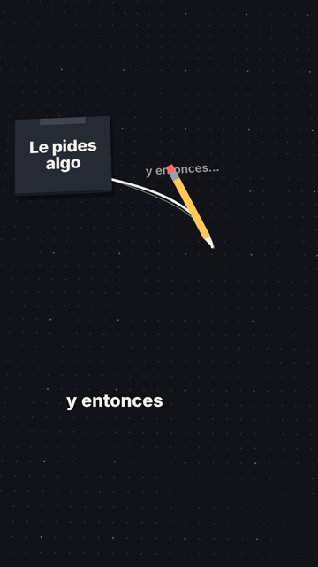
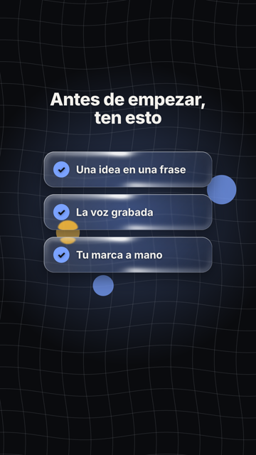

# video-studio

Un estudio de vídeo que se maneja hablando con tu IA. Le pides "hazme un reel de 20 segundos con estos tres puntos" y tu IA escribe el vídeo como una página animada (textos, animaciones, captions palabra a palabra, 3D) y lo convierte en un archivo de vídeo **en tu ordenador**.

Antes de cada vídeo te pregunta qué **estilo visual** quieres (cara a cámara, pantalla partida, texto detrás de ti, personaje 3D, mundo 3D, pizarra viva, reel sin cara, tarjetas de vidrio, gancho generado con IA) y lo arma con **tu marca**, que saca de tus propios archivos (manual, logos, web).

<p>
    
   
</p>

Catálogo completo: [`estilos/README.md`](estilos/README.md).

## Para quién
Para quien hace contenido (reels, shorts, stories, vídeos para su web) y quiere hacerlo pidiéndolo en palabras normales, sin aprender un editor. No hace falta saber programar: la IA instala, pregunta y te muestra todo antes de renderizar.

## Qué necesitas
<!-- IA:fuente -->
- **Una IA que trabaje en tu ordenador con acceso a la terminal.** Probado con **Claude Code** (app de escritorio, extensión de VS Code o terminal). Con **Codex** y con otros agentes que leen `AGENTS.md` (Cursor, Gemini CLI, Antigravity…) está preparado pero sin probar de punta a punta. El chat de una IA en el navegador no sirve: no puede instalar ni renderizar.
<!-- /IA -->
<!-- IA:claude -->
- **Claude Code** (app de escritorio, extensión de VS Code o terminal). Es con lo que está probado.
<!-- /IA -->
<!-- IA:codex -->
- **Codex** (app, extensión de VS Code o terminal). Preparado para Codex, sin probar de punta a punta.
<!-- /IA -->
<!-- IA:otra -->
- **Una IA agéntica con acceso a la terminal que lea `AGENTS.md`.** Preparado, sin probar con tu herramienta.
<!-- /IA -->
- Un ordenador con macOS, Windows o Linux (probado en macOS con chip Apple).
- Unos 2-3 GB libres para todo lo que se descarga.

## Qué cuesta (de verdad)
| Pieza | Cuesta |
|---|---|
| Este repo | Gratis (licencia MIT) |
| Hyperframes, GSAP, Three.js, FFmpeg, Node.js, whisper, Rhubarb | Gratis (código abierto o licencia gratuita) |
| Renderizar, transcribir, recortar a la persona, lip-sync | Gratis: corre en tu ordenador |
| **La IA que lo maneja** | **De pago**, aparte: un plan que la incluya o su API. Instalar y hacer cada vídeo gasta uso de tu plan |
| Clon de voz (ElevenLabs), avatar (HeyGen), IA de vídeo para ganchos | **De pago y opcionales**, con tu cuenta. Tu IA te pregunta antes de cada gasto |

## Cómo empezar
<!-- IA:fuente -->
1. Elige el prompt de tu IA en [`PROMPT-INSTALACION.md`](PROMPT-INSTALACION.md) (Claude Code, Codex u otra IA agéntica) y pégaselo: clona el repo y sigue `ONBOARDING.md`.
2. O hazlo a mano: `git clone https://github.com/IAbyLio/video-studio`, abre la carpeta con tu IA y dile **"Sigue ONBOARDING.md"**.
3. El primer paso del onboarding deja la carpeta solo con los archivos de tu IA (por ejemplo, con Claude Code se queda `CLAUDE.md` y se quita `AGENTS.md`). Después te pregunta qué quieres hacer, qué cuentas tienes, dónde están tus archivos de marca y dónde publicas, y hacen juntos un primer vídeo de unos segundos.
4. Desde ahí, en una sesión nueva dentro de la carpeta: *"Hazme un vídeo de…"*.
<!-- /IA -->
<!-- IA:claude,codex,otra -->
En una sesión de tu IA abierta en esta carpeta, pide *"Hazme un vídeo de…"*. Si el onboarding quedó a medias, dile **"Sigue ONBOARDING.md"** y retoma donde quedó.
<!-- /IA -->

Siempre te deja una **vista previa** en el navegador y te pregunta antes de hacer el vídeo final. El resultado queda en `proyectos/<nombre>/renders/`; lo subes tú.

<!-- IA:claude,fuente -->
### Claude Code en la app de escritorio
Abre la app, elige "abrir carpeta" (o arrastra la carpeta) y escribe "Sigue ONBOARDING.md". Cuando te pida permiso para correr un comando, lee qué es y acepta si estás de acuerdo.

### Claude Code en VS Code
Instala la extensión de Claude Code, abre la carpeta en VS Code (Archivo → Abrir carpeta), abre el panel de Claude y escribe "Sigue ONBOARDING.md". Vas a ver los archivos que crea en el explorador de la izquierda.

### Claude Code en la terminal
```bash
cd ruta/a/video-studio
claude
```
y escribe "Sigue ONBOARDING.md". Para ver los vídeos, abre la carpeta `proyectos/` con el Finder o el explorador.
<!-- /IA -->
<!-- IA:codex,fuente -->
### Codex (sin probar de punta a punta)
En la app o en la extensión de VS Code, abre la carpeta como proyecto y escribe "Sigue ONBOARDING.md". En la terminal: `cd ruta/a/video-studio` y `codex`. Codex trabaja en un entorno protegido: te pedirá aprobación para los comandos que bajan cosas de internet (instalar Hyperframes, modelos). Lee qué es cada uno y acepta si estás de acuerdo.
<!-- /IA -->
<!-- IA:otra,fuente -->
### Otra IA agéntica (sin probar)
Abre la carpeta con tu herramienta y escribe "Sigue ONBOARDING.md". Las instrucciones están en `AGENTS.md`, el formato que leen la mayoría de las IA agénticas (Cursor, Gemini CLI, Antigravity y compañía).
<!-- /IA -->

## Qué trae
**En números:** 2 agentes (`video-qa` revisa cada borrador; `video-orquestador`, opcional, coordina piezas largas), 7 skills incluidas en el repo (6 propias y `website-to-hyperframes`, de HyperFrames) más 17 oficiales que instala el onboarding (9 de HyperFrames y 8 de GSAP), 9 estilos visuales más el lienzo en blanco, y 2 estilos de captions (`natural` y `premium`).

| | |
|---|---|
| `estilos/` | 9 estilos visuales + lienzo en blanco, cada uno con ficha, ejemplo que renderiza y miniatura |
| Skills del repo | `nuevo-video` (entrada de cada vídeo: estilo, captions, preguntas y derivación), `analisis-viralidad` (guiones y crítico), `short-form-video` (vertical con cara), `split-screen-panels` (panel alto con la cara arriba), `long-form-video` (horizontal largo), `audio-to-avatar-ad` (anuncio con avatar desde un audio) y `website-to-hyperframes` (vídeo desde una web) |
| Skills oficiales | El set completo de HyperFrames (9) y de GSAP (8), instalado desde su origen por el onboarding y comprobado al final (`node scripts/comprobar-skills.mjs`) |
| `modulos/captions` | Captions palabra a palabra en dos estilos a elegir por vídeo: `natural` (centradas, sobrias) o `premium` (tipografía compuesta que se reparte por la pantalla y puede ir detrás de ti) |
| `modulos/zonas-seguras` | Para que nada quede tapado por los botones de Instagram, TikTok o YouTube |
| `modulos/editar-lo-que-grabas` | Corta silencios, tomas repetidas y muletillas de tu grabación, y la encuadra en vertical (tú confirmas lo dudoso) |
| `modulos/personaje-3d` | Un muñeco 3D neutro que habla con lip-sync, y una guía para hacer tu propio personaje |
| `modulos/mundo-3d` | Escenas 3D deterministas (Three.js) |
| `modulos/voz` · `avatar` · `ganchos-ia` | Tu clon de voz, tu avatar y escenas de IA de vídeo, con tus cuentas |
| `modulos/sonido` | 8 efectos de sonido hechos por código, capas y render por etapas |
| `modulos/viralidad` | Guiones con gancho, estructura de 8 piezas y un crítico que los puntúa |

## Lo que no hace
- No publica en redes: el vídeo queda en tu ordenador.
- No trae voces, avatares, personajes, música ni marca de nadie: cada cosa es tuya.
- No gasta nada de tus cuentas sin preguntarte.

## Créditos y licencias
Hecho por IAbyLio. Por debajo: [Hyperframes](https://hyperframes.heygen.com) (HeyGen, Apache-2.0), GSAP, Three.js y otras piezas de código abierto: detalle en [`LICENCIAS.md`](LICENCIAS.md).
