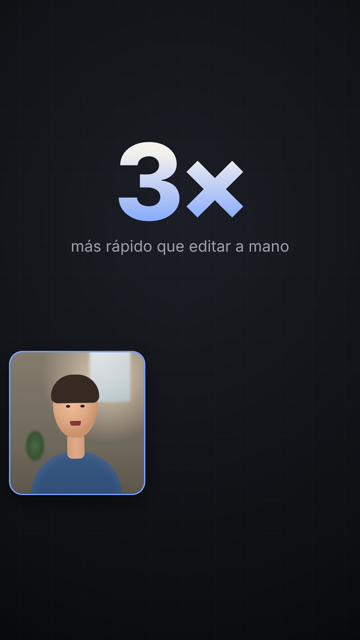
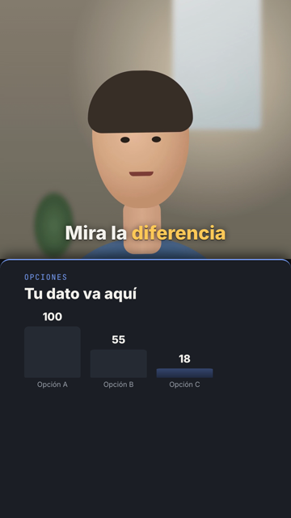
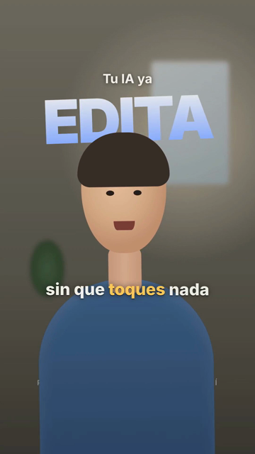
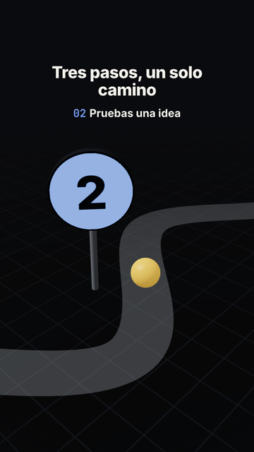
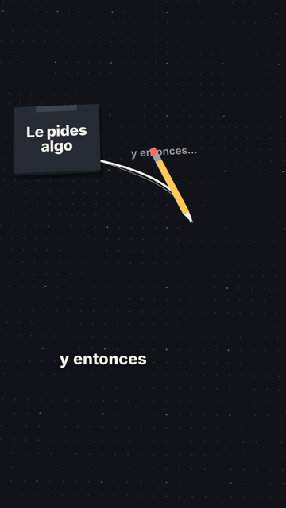
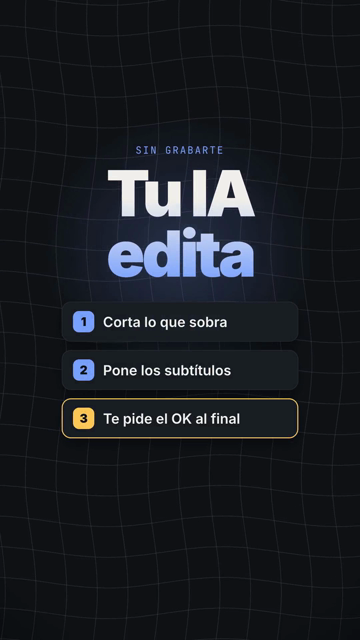
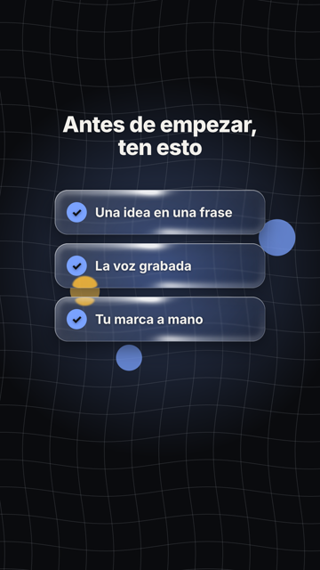
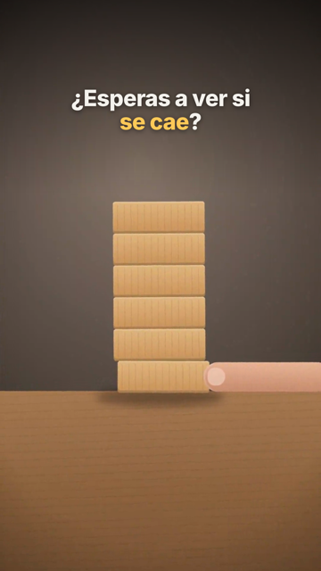

# Estilos visuales

Antes de cada vídeo, tu IA te pregunta qué estilo quieres. No son variantes de un mismo vídeo: son formas distintas de contar. Cada carpeta tiene una `FICHA.md` (qué es, cuándo usarlo, qué necesita, cómo está hecho), un `ejemplo/` que renderiza tal cual y una miniatura.

**Estado:** *probado* = el método se usó en piezas reales aprobadas en el estudio del que sale este repo; *experimental* = método escrito o probado solo en ejemplos. En todos los casos, el ejemplo de la carpeta es una versión mínima hecha para este repo (3-6 s, sin marca), renderizada y revisada fotograma a fotograma. Donde hace falta material tuyo (tu vídeo, tu recorte, un clip generado), el ejemplo usa un relleno hecho por código.

| | Estilo | En una línea | Necesita | Estado |
|---|---|---|---|---|
|  | **Motion graphics desde cero** (`libre`) | Lienzo en blanco con tu marca: textos, formas y animación a medida | Nada | probado |
|  | **Cara a cámara** (`talking-head`) | Tu vídeo o tu avatar con captions palabra a palabra, cámara viva y tres modos de cara: completa, ventana chica, mitad superior | Un vídeo tuyo a cámara o un avatar | probado |
|  | **Pantalla partida** (`split-screen`) | Tu cara arriba y un panel grande abajo (datos, regla, gráfico) sin taparte | Tu vídeo o un avatar | probado |
|  | **Texto detrás del sujeto** (`texto-detras`) | Una palabra gigante que queda detrás de la persona: ella la tapa | Tu vídeo + su recorte (`npx hyperframes remove-background`, local) | probado |
|  | **Personaje 3D que narra** (`personaje-narrador`) | Un muñeco hecho con código habla con lip-sync, señala y reacciona junto a tarjetas y captions en bocadillo | Una voz (grabada, local o clonada) | experimental |
|  | **Mundo 3D / mundo-metáfora** (`mundo-3d`) | Un único mundo 3D que es la metáfora del tema; la cámara lo recorre parada por parada | Nada (tiempo de construcción) | experimental |
|  | **Pizarra viva** (`pizarra-viva`) | Pizarra en perspectiva donde aterrizan notas y un lápiz dibuja conectores al ritmo de la voz, con zoom-out final | La voz definitiva antes de animar | probado |
|  | **Reel sin cara** (`sin-avatar`) | Voz en off con tipografía cinética, tarjetas, fondo de cuadrícula con ondas y efectos de sonido por capas | Una voz | probado |
|  | **Tarjetas de vidrio líquido** (`liquid-glass`) | Lista y llamada a la acción en tarjetas de vidrio que refractan de verdad lo que tienen detrás | Algo detrás que refractar | probado |
|  | **Gancho generado con IA** (`gancho-ia`) | Escena física generada con IA de vídeo, congelada en la tensión, con el objeto que habla y el desenlace al final | Un clip de IA de vídeo (de pago, con tu cuenta) | probado |

Rutas de las miniaturas: `talking-head/miniatura.png`, `split-screen/miniatura.png`, `texto-detras/miniatura.png`, `personaje-narrador/miniatura.png`, `mundo-3d/miniatura.png`, `pizarra-viva/miniatura.png`, `sin-avatar/miniatura.png`, `liquid-glass/miniatura.png`, `gancho-ia/miniatura.png`.

## Usar un estilo
```bash
node scripts/nuevo-proyecto.mjs mi-reel --estilo pizarra-viva --formato reel
cd proyectos/mi-reel && npx hyperframes preview
```
Copia el ejemplo con tu marca puesta y un `BRIEF.md`. A partir de ahí, tu IA lo adapta a tu contenido siguiendo la ficha.

## Ver un ejemplo tal cual
```bash
cd estilos/<id>/ejemplo
npx hyperframes render --quality draft --output renders/ejemplo.mp4
```

## Combinar
Los estilos se mezclan: un *cara a cámara* con un tramo de *pantalla partida*, un *reel sin cara* con tarjetas de *vidrio*, un *mundo 3D* con el *personaje* como guía. Elige uno como base y pide el resto por tramos.

## Material de relleno
`_material/` tiene la "persona" hecha por código que usan los ejemplos de cara a cámara (`generar.sh` la regenera: con fondo y recortada). No es nadie: es un hueco para tu vídeo.
