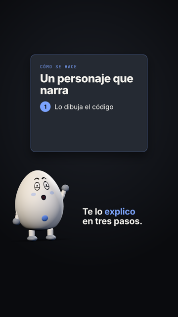

# Estilo: personaje 3D que narra



**Estado: experimental.** El método (personaje 3D por código + cara con lip-sync de Rhubarb) se usó en piezas reales
del estudio del que sale este repo, pero el muñeco de ejemplo es nuevo y solo está probado en el demo y en este
ejemplo, no en un vídeo publicado.

## Qué es

Un personaje hecho con código cuenta el vídeo: habla con lip-sync, cambia de pose y de expresión, y señala lo que
importa. Al lado, el contenido (tarjetas, listas, datos) aparece al ritmo de lo que dice. Nadie sale a cámara.

## Cuándo usarlo

- Cuando no quieres (o no puedes) salir a cámara y una voz en off sola se queda corta.
- Explicaciones paso a paso, "cómo funciona", consejos: el personaje dirige la mirada al contenido.
- Si tu marca ya tiene mascota, o quieres crear una (`modulos/personaje-3d/HAZ-TU-PERSONAJE.md`).
- No conviene cuando el valor del vídeo es tu cara, tu credibilidad personal o algo que hay que mostrar filmado.

## Qué necesita

- Una voz para el lip-sync: tu grabación, la voz local de Hyperframes o un clon declarado en `modulos/voz/`. Sin voz
  se puede maquetar con bocas sintéticas, pero el vídeo final necesita la voz.
- Rhubarb (gratis) para sacar las bocas: `bash scripts/personaje/instalar-rhubarb.sh`.
- El personaje: el muñeco de ejemplo o el tuyo.

## Cómo se construye

1. Voz primero: el ritmo lo manda la voz. Transcríbela (`npx hyperframes transcribe voz.wav --model small --language es`)
   para tener el segundo exacto de cada palabra.
2. Bocas: `node scripts/personaje/build-mouth-data.mjs --audio voz.wav --guion guion.txt --out bocas.json --js assets/boca-data.js --var MOUTH`.
3. Guion del personaje: poses y expresiones ancladas a palabras (`setGuion`), con la palabra en un comentario.
4. Encuadre de reel: narrador `cx 250 · pies 1455 · alto 430`, bocadillo de captions a su derecha (x 500–895 ·
   y 1180–1440), contenido arriba (y 330–920). Ver el bloque de bandas en el CSS del ejemplo.
5. Contenido que entra cuando se nombra (no antes): si dice "el segundo", el 2 se ilumina en ese instante.
6. Verificación: fotogramas en momentos de habla y de silencio (boca abierta / cerrada), y overlay de zonas seguras en
   las poses con los brazos arriba.

## El ejemplo

`ejemplo/`: 5 s, el muñeco abajo a la izquierda saluda, señala y celebra; una tarjeta con tres pasos y captions en
bocadillo. Bocas sintéticas (no hay audio). Para probarlo con voz, mira `modulos/personaje-3d/muneco/preparar-demo.mjs`.

```bash
cd estilos/personaje-narrador/ejemplo
npx hyperframes lint
npx hyperframes render --quality draft --output renders/ejemplo.mp4
```

Al clonarlo con `node scripts/nuevo-proyecto.mjs <nombre> --estilo personaje-narrador`, el muñeco toma los colores de
tu marca (lee las variables de `marca/marca.css`).
