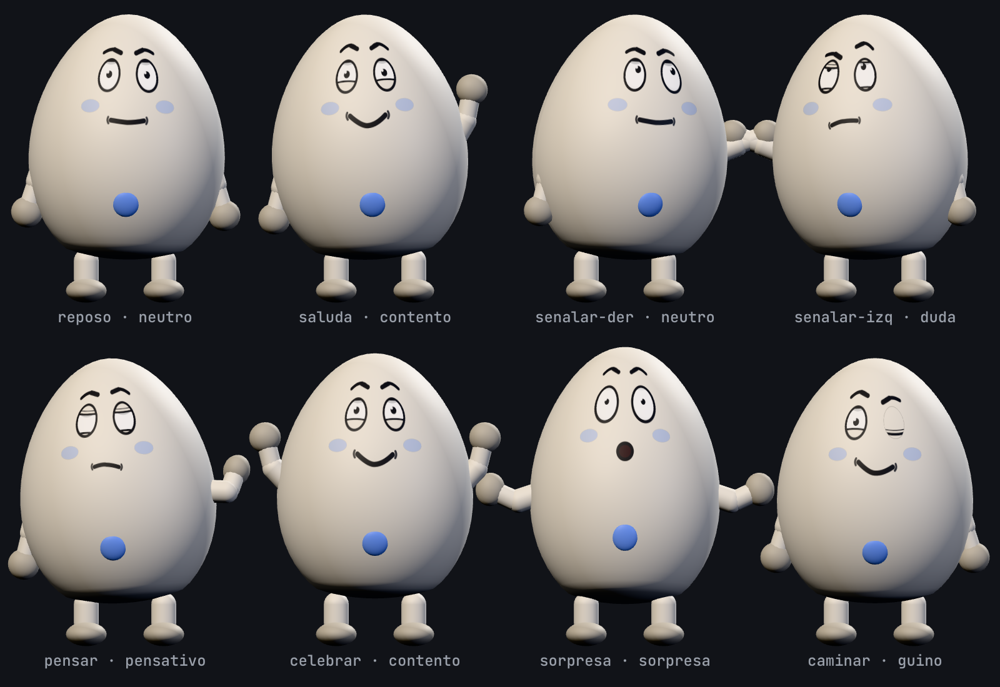

# Muñeco (personaje de ejemplo)

> Ficha del personaje que trae el repo. No es la mascota de nadie: es una base neutra para aprender el motor y para
> copiarla cuando hagas el tuyo (`../HAZ-TU-PERSONAJE.md`). Estado: experimental (probado en el demo y en el estilo
> `personaje-narrador`, todavía no en una pieza publicada).



## Qué es

- Una gota (forma de huevo, más ancha abajo) con la cara pintada como calcomanía, bracitos y piernitas cortos con
  manos y pies redondos, y un botón de color en la panza.
- Hecho 100 % con código: Three.js para el cuerpo y `scripts/personaje/cara.js` para la cara (ojos con párpados,
  cejas, boca con 9 formas para el lip-sync). Sin imágenes ni modelos descargados.
- Todo es función pura del tiempo: el mismo segundo da siempre el mismo fotograma (se puede saltar hacia atrás).
- Se reconoce a 120 px de alto por la silueta de huevo clara sobre fondo oscuro y el punto de color en la panza.

## Archivos

| Archivo | Qué es |
|---|---|
| `personaje.js` | El motor del muñeco: `Personaje.crear(THREE, opciones)` (contrato en la cabecera del archivo) |
| `poses.json` | Poses, expresiones, "vida" (respiración, parpadeo, bote al hablar) y medidas de la cara. Se edita a mano |
| `hoja-modelo.png` | Todas las poses en una lámina. Se regenera con `node modulos/personaje-3d/muneco/hacer-hoja.mjs` |
| `demo/` | Proyecto Hyperframes de 6 s: el muñeco entra caminando, saluda, señala y celebra |
| `preparar-demo.mjs` | Pone una voz en el demo y le saca las bocas con Rhubarb (`--quitar` lo deja como venía) |

## Poses (8) y expresiones (6)

| Pose | Cuándo |
|---|---|
| `reposo` | Por defecto mientras habla |
| `saluda` | Entrada, "hola" (la mano se mueve sola: ciclo `saludar`) |
| `senalar-der` / `senalar-izq` | Mandar la mirada a un contenido de ese lado de la pantalla |
| `pensar` | Antes de una pregunta o un "a ver…" |
| `celebrar` | Cierre, logro |
| `sorpresa` | Dato inesperado, gancho |
| `caminar` | Entrar o salir de cuadro (ciclo de piernas y brazos; el desplazamiento lo pone `offset`) |

Expresiones: `neutro`, `contento`, `sorpresa`, `duda`, `pensativo`, `guino`.

## Cambiarle los colores

Por defecto toma la paleta neutra de `personaje.js`. En un proyecto, `Personaje.paletaDesdeCSS()` lo viste con tu
marca (lee `--texto` para el cuerpo, `--texto-suave` para manos y pies, `--acento` para el botón y las mejillas y
`--fondo-hondo` para ojos y boca). También puedes pasar colores sueltos:

```js
const p = Personaje.crear(THREE, { paleta: { cuerpo: "#ffd6a5", acento: "#ff6b6b", tinta: "#222222" } });
```

Claves: `cuerpo`, `sombra` (manos y pies), `acento`, `tinta` (ojos y boca), `brillo`, `lengua`, `interior`.

## Sumar o tocar una pose

1. En `poses.json`, copia una pose y cámbiale el nombre.
2. Los números son grados que se SUMAN a la postura de base de cada articulación (`cuerpo`, `hombroI`, `hombroD`,
   `codoI`, `codoD`, `piernaI`, `piernaD`; I/D = izquierda/derecha de la pantalla). En el hombro, `z` positivo sube el
   brazo derecho y `z` negativo sube el izquierdo; `x` lo adelanta o atrasa.
3. `mira: [x, y]` mueve las pupilas (-1..1). `ciclo` suma un movimiento repetido (`caminar`, `saludar`).
4. `node modulos/personaje-3d/muneco/hacer-hoja.mjs` y mira la hoja. Después `node scripts/sincronizar-copias.mjs`
   para que el demo y el estilo `personaje-narrador` usen la versión nueva.

## Posición en un reel 9:16

| Uso | Posición | Notas |
|---|---|---|
| Narrador a un lado | `cx 250 · pies 1455 · alto 430` | Caja ≈ x 60–440 · y 1025–1455. Bocadillo de captions a su derecha: x 500–895 · y 1180–1440 |
| Protagonista | centrado en x 540, pies en y 1440, alto 700–800 | Con los brazos arriba (saluda, celebrar) la mano sube hasta ≈ y 950: no entra en la columna de botones |

Compruébalo siempre con `node scripts/zonas-seguras.mjs <fotograma.png> --format reel`: cuenta todo el recorrido de los
brazos, no solo el reposo.

## Qué NO es

No tiene voz propia: habla con la que le pongas (tu grabación, la voz local de Hyperframes o un clon declarado en
`modulos/voz/perfiles.json`). Y no tiene personalidad escrita: si lo usas de narrador, escríbele la tuya con la
plantilla de `../HAZ-TU-PERSONAJE.md`.
